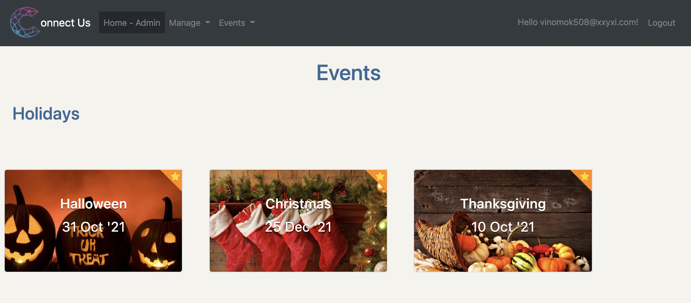
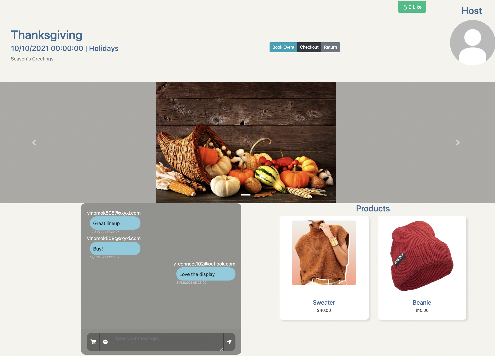
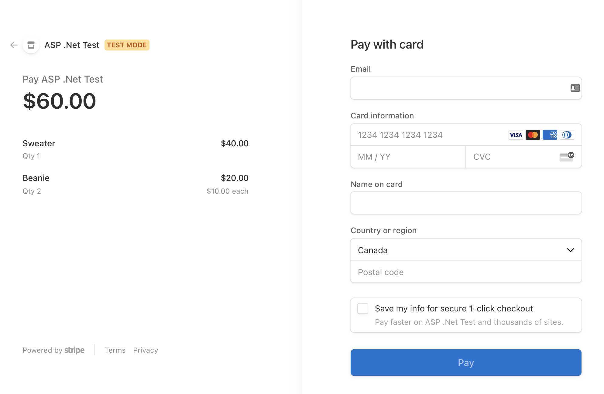
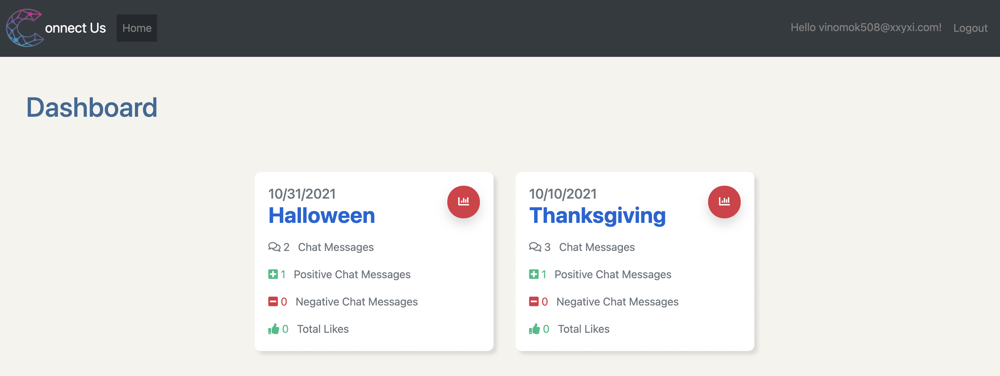
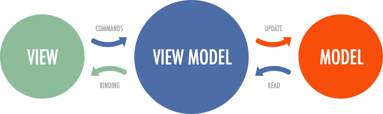

onnect-Us

  <a href="#-basic-overview">Basic Overview</a> •
  <a href="#-app-screenshots">App Screenshots</a> •
  <a href="#-mvvm-architecture">MVVM Architecture</a> •
  <a href="#-docker-containers">Docker Containers</a> •
  <a href="#-usage">Usage</a> •
  <a href="#-folder-structure">Folder Structure</a>

  

## 📌 Basic Overview 

Connect-Us is an e-commerce social media platform for influencers to put their products on display while staying engaged with shoppers. The features include managing events, products, tracking social media sentiment through chat-rooms, and providing a Stripe checkout. Shoppers can attend these events when they begin and view the display of products that event creators have to offer.

## 📷 App Screenshots

Home         |  Event   |    Checkout      |     Dashboard
:-------------------------:|:-------------------------:|:-------------------------:|:-------------------------:
 || |

## 📷 MVVM Architecture
 
The Model–view–viewmodel (MVVM) was used in .NET Core through Razor pages. It separates the user-interface (view) from the business logic (model) through use of the viewmodel. The viewmodel is responsible for converting the data objects from the model's entities to in a way that is easily presentable for the view, allowing the view to not have to manage its own display logic. 

## 📷 Docker Containers
| Container | Description |
| --- | --- |
| app | Uses the dotnet sdk image to compile the app and install the runtime for the .NET application |
| reverse proxy | Uses the nginx image to serve as an intermediary proxy service. The container retrieves a client request, passes it upstream to the app container which is hosting the application's server, and subsequently delivers the server's response back to the client |
| database | Uses the azure-sql image to provide an mssql database for the app to read and write in. |
| node | Uses the node image to compile Sass and provide node modules to be used for the future. |

## 📷 Usage

### To run on a development environment:
#### On First Start 
    $ docker-compose build
#### After First Start
    $ docker-compose up 
---

### Useful commands for developers:
#### To add a Database Migration (note - replace MyTest with useful migration name)
    $ docker-compose stop && docker run -v ${PWD}:/app --rm --entrypoint /bin/sh connect-us_app -c 'dotnet ef migrations add MyTest' && docker-compose up
#### To compile SASS after running containers
    $ docker start connect-us_node_1
#### To stop containers
     $ docker-compose stop
#### To remove containers
     $ docker-compose down
#### To remove Database to start from scratch
     $ docker rm connect-us_db_1 -f && docker volume rm connect-us_mysqldata -f

---
### To run on staging environment:
#### On First Start 
    $ docker-compose -f docker-compose.staging.yml build
#### After First Start
    $ docker-compose -f docker-compose.staging.yml up 
#### To add a Database Migration 
    $ docker-compose stop && docker run -v ${PWD}:/app --rm --entrypoint /bin/sh connect-us_app -c 'dotnet ef migrations add MyTest' && docker-compose -f docker-compose.staging.yml up

## 📷 Folder Structure

Key pieces of the application are shown below.

├── ConnectUs
│   ├── Areas
│   │   ├── Account
│   │   ├── Admin
│   │   ├── Attendee
│   │   ├── Creator
│   │   └── Events
│   ├── ConnectUs.csproj
│   ├── Controllers       
│   ├── Hubs
│   ├── Migrations
│   ├── Model          
│   ├── Program.cs
│   ├── Properties
│   ├── Services
│   ├── Startup.cs
│   ├── appsettings.Development.json
│   ├── appsettings.json
│   ├── docker               
│   │   ├── app
│   │   │   ├── Dockerfile
│   │   │   ├── dev-entrypoint.sh
│   │   │   ├── dev.Dockerfile
│   │   │   └── entrypoint.sh
│   │   ├── nginx
│   │   │   ├── Dockerfile
│   │   │   └── nginx.conf
│   │   └── node
│   │       ├── Dockerfile
│   │       ├── dev.Dockerfile
│   │       └── entrypoint.sh
│   ├── package.json
│   ├── webpack.config.js
├── README.md
├── docker-compose.staging.yml
└── docker-compose.yml

